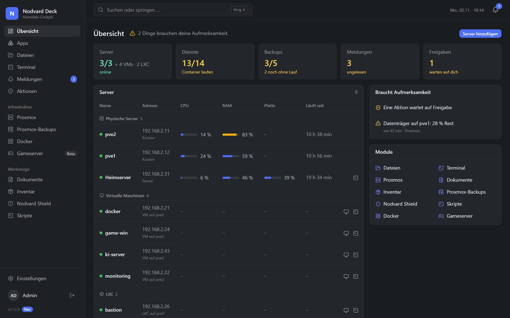
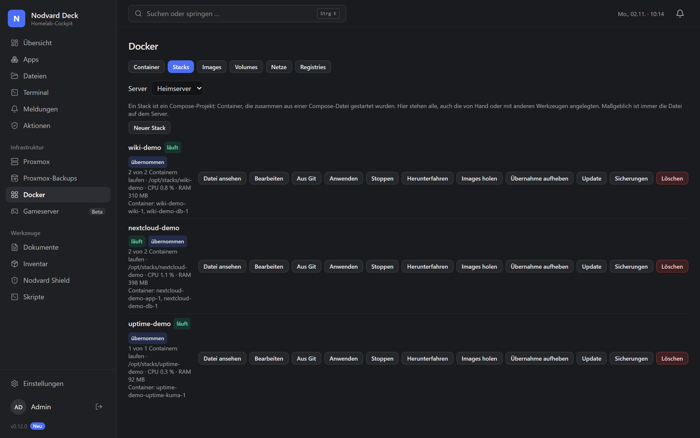
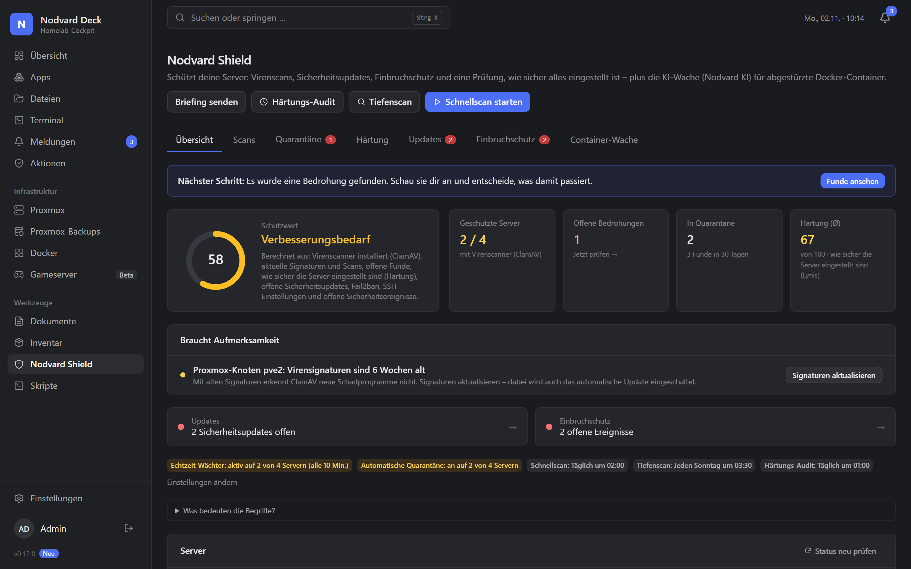
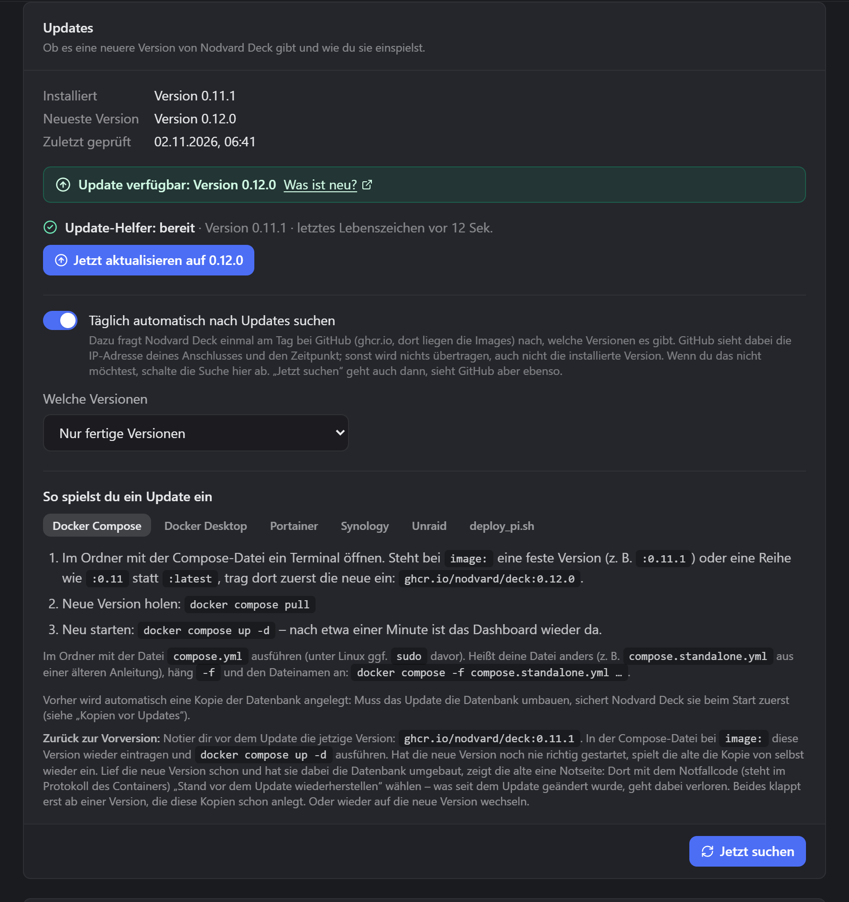

<div align="center">

# Nodvard Deck

Self-hosted, source available to read (PolyForm Noncommercial), free for personal use

**One dashboard for your whole homelab: servers, VMs, containers, backups, security and more.**

[Deutsch](README.md) · [Documentation](docs/README.md) · [Quick start](#quick-start-in-5-minutes) · [Discord](https://discord.gg/gTTs7qMabt) · [Feedback](CONTRIBUTING.md)

[](https://github.com/nodvard/deck/releases/latest)
[](LICENSE)


The web interface is currently available in German only. This README is also available in [German](README.md).

</div>

---

Nodvard Deck bundles the state, logs and actions of your homelab in **one web interface**, with an **approval gate**
for changes to your servers. Every server gets its own page with its status, live load, actions and settings.
Whatever changes something is started by you or released through an approval; the exceptions are listed under
[Security and privacy](#security-and-privacy-at-a-glance). Some modules are still beta or read-only (see the tables
under [Features](#features)).

> **Status:** Nodvard Deck is in active development (beta). It runs 24/7 in a real homelab,
> but APIs and data formats may still change between versions.

## Why a noncommercial license?

Nodvard Deck is built by a single developer who chose PolyForm Noncommercial to prevent commercial marketing without agreement while keeping all source code available to read.
You may use, modify and redistribute Deck for personal and other noncommercial purposes under the terms of [LICENSE](LICENSE); commercial use and marketing require separate permission.
For exceptions, contact the developer at **kontakt@nodvard.com** or on [Discord](https://discord.gg/gTTs7qMabt).

## What Deck can and cannot do

- **One view of your homelab:** status, logs and actions for supported services in one place; additional services need a suitable extension.
- **With or without Proxmox:** connect Linux servers via SSH; Deck does not install Docker or your applications for you.
- **Access rights matter:** an SSH account is required, and some features need root rights or the practically equivalent `docker` group.
- **You control changes:** actions can be approved and logged; enabled automation and the antivirus quarantine, enabled by default, can act without another click.
- **Security tools have limits:** scans, audits and warnings help you check; they cannot guarantee a secure server or detect every attack.
- **Backups need a second location:** Deck can encrypt backups of its data; a backup in the same volume does not protect against that disk failing.
- **Beta for personal operation:** Deck runs around the clock in a homelab, with no guaranteed availability or 24/7 support; data formats may change and some modules only read.
- **The interface is German:** documentation is also available in English; an English user interface is currently unavailable.

## What it looks like

| Overview | Docker |
|---|---|
|  |  |
| **Nodvard Shield** | **Updates** |
|  |  |

The screenshots show sample data (the interface is in German for now).

## Features

**Core**
- Dashboard with freely arrangeable widgets and a status overview ("cockpit")
- Server pages: status, live CPU/RAM, actions, tools and services per host
- Approval gate: every change is proposed first and only runs after approval (optional autonomy mode, deny list, maintenance windows)
- Users, roles and permissions, two-factor login, audit log
- Encrypted secrets vault for API tokens and SSH credentials
- Web terminal (SSH) and file manager across servers
- Notifications center, push notifications via ntfy
- White-label branding: name, logo and colors are settings, not code
- Installable as an app on phones (PWA)

**Extensions** (each can be switched on or off)

**Servers and infrastructure**

| Extension | What it does |
|---|---|
| Proxmox VE (Proxmox only) | Nodes, VMs and containers: start/stop, console in the browser, snapshots, hardware settings, storage, updates, disk health |
| Proxmox-Backups (Proxmox only) | All Proxmox backups at a glance, create and edit backup jobs, warnings for missing or failed backups |
| Docker | Docker containers on your servers: start/stop, live logs, details, storage cleanup, compose stacks, image update check |
| Server status („Server-Zustand“) | Linux servers over SSH: OS, load, disks, failed services, pending updates |
| Nodvard Shield | Security: antivirus (ClamAV), hardening audits (Lynis), update center, intrusion detection, file integrity monitoring, container watcher |
| Pi-hole (beta) | Statistics, pause and resume blocking, reload block lists, block or allow domains |
| Nginx Proxy Manager (beta) | Switch proxy hosts on and off, certificate expiry, address check against the containers |
| Network (beta) | Only a signpost to Pi-hole and Nginx Proxy Manager now; can stay switched off |
| Scripts | Versioned script repository, run on one or many servers, scheduled, optionally without a click, as long as nothing changes |
| Push-Nachrichten | Push notifications via ntfy and other channels |

**More modules**

| Extension | What it does |
|---|---|
| Game servers (beta) | Start/stop game servers and show the current join code (e.g. Valheim) |
| Documents | Document archive with OCR and full-text search |
| Inventory | Devices and items with purchase data and warranty reminders |
| Nextcloud | Nextcloud as a source in the file manager, plus a tile with version, updates, free space, active users and load |
| Uptime Kuma (beta) | State of all monitors, availability over the last 24 hours, recent outages and expiring certificates (read-only) |
| Home Assistant (beta) | Version, pending updates, unavailable devices and selected values such as temperatures (read-only) |
| Jellyfin (beta) | Current playback with user and device, whether it transcodes, library sizes and recently added media (read-only); everyone with access to the page also sees users and titles |
| Plex (beta) | Current playback with user and device, library sizes and recently added media; talks only to your own server, never to plex.tv (read-only); everyone with access to the page also sees users and titles |
| qBittorrent (beta) | Speed, active torrents, count per state and free space (read-only); everyone with access to the page also sees the torrent names |
| Synology DSM (beta) | Model, DSM version, load, storage pools, volumes, disks, Hyper Backup and whether an update is available (read-only); reports when something is wrong; best with a dedicated DSM account without two-factor, and for storage, updates and Hyper Backup a member of the "administrators" group |
| Vaultwarden (beta) | Whether your password manager is running, which version, whether it is reachable over HTTPS and whether strangers can sign up; Nodvard Deck never sees a password (read-only) |

"Beta" means: the extension works, but is not yet as thoroughly tested as the rest. Feedback helps.

You do **not** need Proxmox: a Raspberry Pi, a Debian VM, a NAS or a few Docker hosts are enough. You add
servers by hand; load, Docker containers, updates and security all work over SSH.

Extensions are built against a documented SDK, so you can write your own:
see [docs/en/EXTENSION-API.md](docs/en/EXTENSION-API.md).

## Quick start in 5 minutes

### Starting with Docker Compose

**Requirements:** Docker with Docker Compose. Nodvard Deck runs fine on a Raspberry Pi 4/5 (arm64) as well as on any
x86-64 machine. Nothing is built: the ready-made image comes from the GitHub Container Registry
(`ghcr.io/nodvard/deck`).

Five minutes is an estimate with Docker, Docker Compose and a reachable Linux server with SSH access already available.
The initial image download or setup on the server can take longer.

1. **Start Deck:** Download the file and start it in the same folder:

```bash
mkdir ~/nodvard-deck && cd ~/nodvard-deck
curl -fsSL -o compose.yml https://raw.githubusercontent.com/nodvard/deck/main/deploy/compose.standalone.yml
docker compose up -d
```

Nodvard Deck is then reachable on port 8080 (change it with `NODVARD_DECK_PORT`). All data lives in the Docker volume
`nodvard-deck-data`, at `/app/data` inside the container. The complete file is
[deploy/compose.standalone.yml](deploy/compose.standalone.yml).

2. **First login:** Open `http://localhost:8080` or `http://<your-server>:8080` and get the **Einrichtungscode**
   (setup code) with `docker compose logs nodvard-deck`. Create your own owner account with a username and password
   in the wizard; there is no default password. Use this account for future logins
   ([setup, section 2](docs/en/FIRST-SETUP.md#2-setup-wizard-setup)).
3. **Connect your first server:** Go to **Einstellungen → Server & Zugänge → Server hinzufügen** (settings,
   servers and access, add server), enter its name and address, generate an SSH key, run the displayed setup command
   on the target server and select **Verbindung prüfen** (check connection). Compare the displayed server key before
   accepting it ([setup, section 3](docs/en/FIRST-SETUP.md#3-connect-your-first-server)).
4. **View your first module:** Enable **Server-Zustand** (server health) under **Einstellungen → Erweiterungen**
   (settings, extensions) and open the connected server's page. Start with the status values that only read;
   restarting services needs additional rights ([setup, section 4](docs/en/FIRST-SETUP.md#4-enable-extensions)).

**Windows:** the commands are for a Linux shell (also WSL or Git Bash). In PowerShell, write
`curl.exe` instead of `curl` and run the commands one by one.

**Note:** the web interface, including the setup assistant, is currently in German only.

- **Open:** `http://<your-server>:8080`
- **Port already in use?** (message "port is already allocated" or "address already in use"): put a file
  `.env` with the line `NODVARD_DECK_PORT=8081` next to `compose.yml` and run `docker compose up -d` again.
  The address is then `http://<your-server>:8081`.
- **Setup code:** the German log line starts with "Einrichtungscode". The code stays the same across restarts until
  the owner account exists; after that it is no longer needed.
- **Updating:** in the same folder, `docker compose pull && docker compose up -d`. Your data is kept.

<details>
<summary><b>Portainer, way 1: from the repository</b></summary>

1. **Stacks → Add stack**, name e.g. `nodvard-deck` (lowercase letters, digits, `-` and `_` only).
2. Choose **Repository** as the build method and enter:
   - **Repository URL:** `https://github.com/nodvard/deck`
   - **Repository reference:** `refs/heads/main`
   - **Compose path:** `deploy/compose.standalone.yml`

   You do not need to log in; the repository is public.
3. **Deploy the stack**.

- **Open:** `http://<your-server>:8080`
- **Port already in use?** Under **Environment variables**, add the variable `NODVARD_DECK_PORT` with e.g.
  `8081`: for a new stack before "Deploy the stack", for an existing one followed by a redeploy
  ("Pull and redeploy"). The address is then `http://<your-server>:8081`.
- **Setup code:** **Containers** → `nodvard-deck-nodvard-deck-1` (in general
  `<stack-name>-nodvard-deck-1`) → **Logs**; the line is in German and starts with "Einrichtungscode".
- **Updating:** in the stack, **Pull and redeploy** with **Re-pull image** switched on. You can optionally
  switch on Portainer's automatic updates ("Automatic updates", in newer versions "GitOps updates"): they
  pick up changes to the Compose file in the repository on their own. A new version of Nodvard Deck,
  however, is a new image and not a change to the file; you get it with "Pull and redeploy".

</details>

<details>
<summary><b>Portainer, way 2: web editor</b></summary>

1. Open the file [deploy/compose.standalone.yml](deploy/compose.standalone.yml)
   ([as plain text](https://raw.githubusercontent.com/nodvard/deck/main/deploy/compose.standalone.yml))
   and copy its **entire content**. It starts with `# Nodvard Deck ohne das Repository installieren` and
   contains `services:` further down.
2. **Stacks → Add stack**, name e.g. `nodvard-deck`, choose **Web editor** as the build method, paste the
   content, **Deploy the stack**.

Do **not** paste the three commands from the terminal way (`mkdir …`, `curl …`, `docker compose up -d`).
They are shell commands, not a Compose file; Portainer then reports "top-level object must be a mapping".

- **Open:** `http://<your-server>:8080`
- **Port already in use?** Under **Environment variables**, add the variable `NODVARD_DECK_PORT` with e.g.
  `8081`: for a new stack before "Deploy the stack", for an existing one followed by "Update the stack".
  The address is then `http://<your-server>:8081`.
- **Setup code:** **Containers** → `nodvard-deck-nodvard-deck-1` (in general
  `<stack-name>-nodvard-deck-1`) → **Logs**; the line is in German and starts with "Einrichtungscode".
- **Updating:** open the stack → **Editor** → **Update the stack** with **Re-pull image and redeploy**
  switched on. You do not need to change anything in the editor for that.

</details>

<details>
<summary><b>Raspberry Pi</b></summary>

- A Raspberry Pi 4 or 5 with 4 GB RAM and a **64-bit system** (`uname -m` shows `aarch64`); the image is
  available for `linux/arm64`. When idle, Nodvard Deck needs about 100 MB of memory; the image is just
  under 400 MB. Docker with Docker Compose has to be installed.
- An SD card can die: do not keep backups only on the Pi
  ([section 6 of the guide](docs/en/FIRST-SETUP.md#6-back-up-the-dashboard-itself)); a USB SSD lasts
  longer than an SD card.
- If Portainer runs on the Pi, the two Portainer ways above work the same.

```bash
mkdir ~/nodvard-deck && cd ~/nodvard-deck
curl -fsSL -o compose.yml https://raw.githubusercontent.com/nodvard/deck/main/deploy/compose.standalone.yml
sudo docker compose up -d
```

If your user is in the `docker` group, leave out `sudo`. The first start takes a while because the image
has to be downloaded first.

- **Open:** `http://<address-of-the-pi>:8080`
- **Port already in use?** Put a file `.env` with the line `NODVARD_DECK_PORT=8081` next to `compose.yml`
  and run `sudo docker compose up -d` again. The address is then `http://<address-of-the-pi>:8081`.
- **Setup code:** `sudo docker compose logs nodvard-deck` in the same folder; the log line is in German and
  starts with "Einrichtungscode".
- **Updating:** in the same folder, `sudo docker compose pull && sudo docker compose up -d`. Your data is
  kept.

</details>

**Further ways**, each step by step in
[docs/en/INSTALLATION.md, installation per platform](docs/en/INSTALLATION.md):

- **In a terminal:** a single `docker run` command, Podman
  ([guide](docs/en/INSTALLATION.md#in-a-terminal))
- **With a web interface:** Dockge ([guide](docs/en/INSTALLATION.md#with-a-web-interface))
- **On a NAS:** Synology, UGREEN, QNAP, Unraid, TrueNAS SCALE, OpenMediaVault, ZimaOS and CasaOS
  ([guide](docs/en/INSTALLATION.md#on-a-nas))
- **On particular machines:** Proxmox (VM or LXC container) and Docker Desktop for trying it out
  ([guide](docs/en/INSTALLATION.md#raspberry-pi-proxmox-and-docker-desktop))

Then follow the setup assistant in the browser. Servers, SSH access, modules and backups are set up in the web interface.

The full step-by-step guide (setup code, SSH access, Proxmox token, push notifications,
backups of Nodvard Deck itself, emergency commands) is in
[docs/en/FIRST-SETUP.md](docs/en/FIRST-SETUP.md).

### Further ways

For these ways, Docker or Podman alone is enough in some cases. Each one is described step by step in
[docs/en/FIRST-SETUP.md, section 1.1](docs/en/FIRST-SETUP.md#11-installation-without-the-repo):

- **In a terminal:** a single `docker run` command, Podman
  ([guide](docs/en/FIRST-SETUP.md#in-a-terminal))
- **With a web interface:** Portainer (from the repository or with the web editor) and Dockge
  ([guide](docs/en/FIRST-SETUP.md#with-a-web-interface)). In Portainer's web editor, paste the **content** of the
  Compose file, not the commands from the quick start; otherwise Portainer reports "top-level object must be a
  mapping".
- **On a NAS:** Synology, UGREEN, QNAP, Unraid, TrueNAS SCALE, OpenMediaVault, ZimaOS and CasaOS
  ([guide](docs/en/FIRST-SETUP.md#on-a-nas))
- **On particular machines:** Raspberry Pi, Proxmox (VM or LXC container) and Docker Desktop for trying it out
  ([guide](docs/en/FIRST-SETUP.md#raspberry-pi-proxmox-and-docker-desktop))

**Building from source** (developers): clone the repository, then run `docker compose build --pull && docker compose up -d`
in `deploy/`. Build, deployment and backup/restore details: [deploy/README.md](deploy/README.md).

## Security and privacy at a glance

- **No telemetry:** The supplied code contains no reporting of usage or crash data to Nodvard or an analytics
  service. Network connections serve the functions listed below; see the
  [backend dependencies](backend/pyproject.toml), [frontend dependencies](frontend/package.json),
  [frontend entry point](frontend/src/main.tsx) and the connection implementations linked below.
- **Deck itself checks for updates:** once a day Nodvard Deck queries `ghcr.io` for a new
  version. It also fetches the release approval and signature from `github.com`, with possible redirects to
  `objects.githubusercontent.com` or `release-assets.githubusercontent.com`. These servers see your IP address and
  the time (can be switched off, details in
  [docs/en/FIRST-SETUP.md, section I.1](docs/en/FIRST-SETUP.md#105-finding-and-installing-a-new-version)). The daily
  check is enabled by default and does not install an update
  ([schedule and switch](backend/src/nodvard_deck/services/update_check.py),
  [destinations and signature verification](backend/src/nodvard_deck/core/updates.py)).
- **Configured connections:** Deck uses SSH or APIs to contact the servers and services you enter.
  Custom app tiles only store links; Deck makes no automatic connections to their target addresses
  ([Custom app links](backend/src/nodvard_deck/services/custom_apps.py)). Language model providers are optional:
  the supplied Ollama integration only contacts configured primary or fallback servers, sending requests,
  server names and, for container analysis, log excerpts; no configured address means no request
  ([Ollama integration](extensions/shield/src/nodvard_deck_ext_shield/ollama.py),
  [request contents](extensions/shield/src/nodvard_deck_ext_shield/__init__.py)).
- **Your servers ask on their own:** Nodvard Shield has them reload their package lists from their package sources once
  a day to find updates. If you switch on the search for newer images in the Docker module (off by default), your
  Docker servers ask the registries of their containers. Docker stacks configured from Git also cause outgoing
  Git connections from Nodvard Deck to the configured repository server
  ([package lists](extensions/shield/src/nodvard_deck_ext_shield/updates.py),
  [image checks](extensions/docker/src/nodvard_deck_ext_docker/image_updates.py),
  [Git fetches](extensions/docker/src/nodvard_deck_ext_docker/git_fetch.py)). When installing updates or images,
  target servers download the packages or images; ClamAV downloads its signatures there
  ([tools and signatures](extensions/shield/src/nodvard_deck_ext_shield/antivirus.py)).
- **Push notifications can leave your network:** when configured in "Push-Nachrichten", selected services such as
  Discord, Telegram, Slack, Pushover and ntfy.sh receive notification content. ntfy and Matrix can also run on your own
  servers. Public ntfy.sh topics without token protection can be read by anyone who knows the topic name
  ([ntfy delivery](extensions/ntfy/src/nodvard_deck_ext_ntfy/__init__.py),
  [other channels](extensions/ntfy/src/nodvard_deck_ext_ntfy/channels.py)).
- **Secrets in the vault:** passwords, tokens and SSH keys are stored encrypted in the database.
  By default, keys live at `/app/data/master.key` and `/app/data/vault_keyring.json` inside the container;
  the keyring also contains new key versions after rotation. Both files are created with `0600` permissions on Linux.
  Anyone with the database and key files can decrypt the secrets
  ([paths](backend/src/nodvard_deck/config.py), [encryption and rotation](backend/src/nodvard_deck/core/vault.py),
  [data volume](deploy/compose.standalone.yml)). Backups made in the web interface
  are always encrypted (with a password or a recovery key); `deploy/backup.sh` only encrypts when a backup key is set up
  in Nodvard Deck, otherwise the file contains the key to the vault.
- **Do not expose it to the internet directly:** Nodvard Deck belongs in your home network or behind a VPN. Behind a
  reverse proxy with HTTPS: [docs/en/REVERSE-PROXY.md](docs/en/REVERSE-PROXY.md).
  To connect your servers through a VPN, see the [Tailscale guide](docs/en/TAILSCALE.md).
- **Rights on your servers:** SSH modules use your server credentials. Where root is needed, Nodvard Deck sets up a narrow sudo rule
  for its own helper scripts only by default, and full rights only for modules without a helper script. The Docker
  module needs the docker group, which amounts to root; if you only want to view, start and stop containers, use the
  "operate only" mode („Nur bedienen“) without the group
  ([docs/en/FIRST-SETUP.md, section F](docs/en/FIRST-SETUP.md#6-root-rights-without-a-password-and-the-docker-group)).
- **No Docker socket for the dashboard:** only the optional update helper gets it, in its own Compose file.
- **Changes need your OK:** whatever changes something on your servers is started by you (risky steps ask first) or
  approved under "Actions" („Aktionen“), and it is logged. Without a click only what you explicitly allow runs: the
  "Act autonomously" mode („Selbstständig handeln“), a standing approval or automatic updates. Of these, only the
  antivirus quarantine is on out of the box: it moves findings right away (reversible, can be switched off).

### Access required by each module

The table lists access rights on target systems. The linked manifests also list internal Deck permissions such as
`hosts.execute`, `net.outbound` and permitted vault access. A module that only reads may still require credentials
with broad privileges. User roles in Deck restrict access to pages and actions
([role checks](backend/src/nodvard_deck/core/rbac.py)).

| Module with permissions in code | Access and limits |
|---|---|
| [Server health](extensions/system/extension.toml) | SSH for reading; service restarts use `sudo` and the `system-root` helper. |
| [Nodvard Shield](extensions/shield/extension.toml) | SSH; scans cover readable files only, full checks, updates and quarantine need root rights through `sudo` and `shield-root`; the container watcher also needs Docker access. |
| [Docker](extensions/docker/extension.toml) | SSH and the `docker` group for full features, practically root rights; "operate only" uses `sudo` with `docker-root` without that group and excludes stack or image management. |
| [Terminal](extensions/terminal/extension.toml), [Scripts](extensions/scripts/extension.toml) | SSH; commands and file access have the logged-in user's rights. Scripts may need extra rights depending on their contents. |
| [Game servers](extensions/gameserver/extension.toml) | SSH with permission to run the start, stop and backup commands in the profile. |
| [Inventory](extensions/inventory/extension.toml) | Manual entries need no server access; hardware discovery uses SSH. |
| [Proxmox VE](extensions/proxmox/extension.toml), [Proxmox backups](extensions/backups/extension.toml) | Dedicated API tokens with read or action privileges; SSH only for additional server features. Separate roles for reading, control and backups: [rights per API call](docs/en/PROXMOX-TOKEN.md). |
| [Pi-hole](extensions/pihole/extension.toml) | API password for statistics and the available changes. |
| [Nginx Proxy Manager](extensions/npm/extension.toml) | Account with access to proxy hosts; enabling and disabling them are changes. |
| [Nextcloud](extensions/nextcloud/extension.toml) | App password with the account's file permissions; metrics use a separate serverinfo token or an admin app password. |
| [Home Assistant](extensions/home-assistant/extension.toml) | A long-lived token from a dedicated user without admin rights is enough; Deck only reads. |
| [Jellyfin](extensions/jellyfin/extension.toml) | API key with administrative privileges, which Jellyfin cannot restrict to reading; Deck only reads. |
| [Plex](extensions/plex/extension.toml) | Token with full account privileges, which cannot be restricted to reading; Deck only reads from your own server. |
| [qBittorrent](extensions/qbittorrent/extension.toml) | WebUI account, unless the WebUI allows access from the network without authentication; Deck only reads. |
| [Synology DSM](extensions/synology/extension.toml) | Dedicated DSM account without two-factor authentication; storage, updates and Hyper Backup usually need `administrators`, even though Deck only reads. |
| [Uptime Kuma](extensions/uptime-kuma/extension.toml) | API key for reading monitors; optional public status page for history. |
| [Vaultwarden](extensions/vaultwarden/extension.toml) | Public status and configuration queries, no admin token and no access to passwords. |
| [Push notifications](extensions/ntfy/extension.toml) | Write access to the configured topic, channel or room, using a token or webhook depending on the service. |
| [Documents](extensions/documents/extension.toml), [Network](extensions/network/extension.toml), [Hello World](extensions/hello-world/extension.toml) | No additional target server credentials; Documents stores and processes files locally, Network links to network modules, Hello World is an SDK example. |

API credentials are described in the `settings.schema.json` next to each manifest; SSH rights and helpers are
explained in [root rights](docs/en/ROOT-RIGHTS.md) and the
[setup service](backend/src/nodvard_deck/services/host_setup.py).

Please do **not** report security issues in public issues. See [SECURITY.md](SECURITY.md).

## Architecture

```
backend/     FastAPI (Python 3.12), SQLAlchemy + SQLite, Alembic migrations
sdk/python/  nodvard_sdk, the stable contract extensions are built against
frontend/    React + Vite + TypeScript + Tailwind web interface
extensions/  one folder per extension (Python backend + bundled frontend)
deploy/      Dockerfile, docker-compose, backup/restore scripts
docs/        architecture, extension API, data model, API reference
```

The core knows no vendor by name. Everything specific (Proxmox, Docker, Pi-hole, …)
lives in extensions. A CI check (`scripts/check_core_purity.py`) enforces this.
More: [docs/en/ARCHITECTURE.md](docs/en/ARCHITECTURE.md).

## Development

```bash
# Backend
python -m venv .venv
.venv/bin/pip install -c deploy/constraints.txt -e sdk/python -e "backend[dev]"
.venv/bin/pytest sdk/python/tests backend/tests
python scripts/check_core_purity.py

# Frontend (in frontend/)
npm ci
npm run typecheck && npm run typecheck:extensions
npm test && npm run test:extensions
npm run build
```

See [CONTRIBUTING.md](CONTRIBUTING.md) for notes on building and checking it yourself.

## How it is tested

Before every release, all tests for backend, frontend and extensions run together with the check scripts (licenses,
core independent of the modules, no secrets in the code), and the image is built as a trial. The release workflow on
GitHub (`.github/workflows/release.yml`) then builds and checks the published images.

## Contributing

Nodvard Deck is free for personal and other noncommercial use, and its source code is available to read.

- **Pull requests** for this repository are not accepted by the project at the moment.
- **Welcome** are bug reports, ideas and feedback: see [CONTRIBUTING.md](CONTRIBUTING.md) for how. Questions, ideas and
  chat: join the [Discord](https://discord.gg/gTTs7qMabt) (mostly German, English is welcome in #english).
- **Welcome** too are your own extensions built with the SDK, see
  [docs/en/EXTENSION-API.md](docs/en/EXTENSION-API.md).

Nodvard Deck is a private, noncommercial project.

## Deck or Dock?

- **Nodvard Deck** is the whole dashboard with all modules: servers, Proxmox, Docker, backups, security and more.
- **[Nodvard Dock](deploy/nodvard-dock/README.en.md)** is the Docker edition of Deck without server modules.
  Pick Dock if you only need containers and stacks: [quick start and documentation](docs/en/dock/README.md).

## License

Nodvard Deck is licensed under the **PolyForm Noncommercial License 1.0.0**, see
[LICENSE](LICENSE). In short (only the license text is binding): you may use Nodvard Deck for personal
and other noncommercial purposes, read the source code and adapt it for yourself. Commercial use,
for example inside a company or as a paid service, is not permitted without separate permission.
Inquiries: **kontakt@nodvard.com**.
The source code is available to read.
Licenses of bundled third-party libraries are listed in [THIRD_PARTY_LICENSES](THIRD_PARTY_LICENSES).

## Trademarks

Proxmox, Docker, Portainer, Synology, Unraid, Nextcloud, Pi-hole, Nginx Proxy Manager, ntfy, Ollama, ClamAV, Lynis,
Fail2ban, Raspberry Pi and other names mentioned are trademarks of their respective owners. Nodvard Deck is not affiliated with them.

© 2026 Nico Benks
