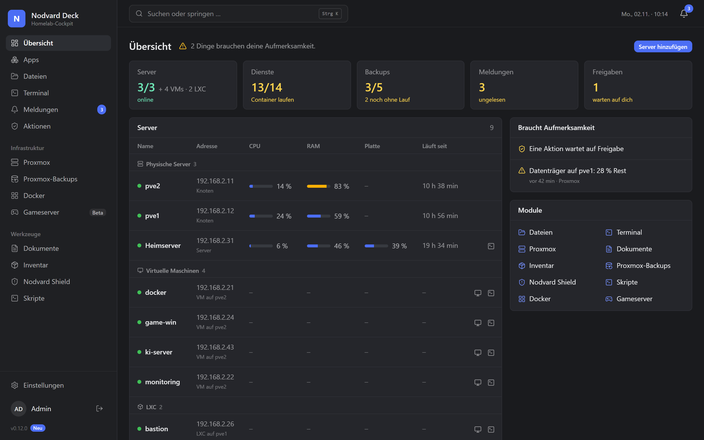
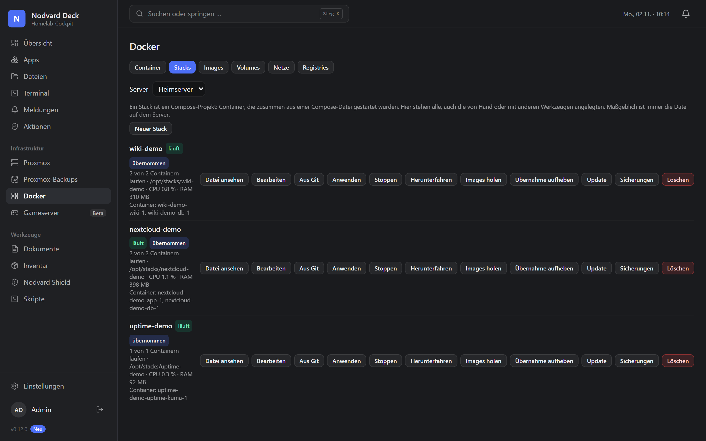
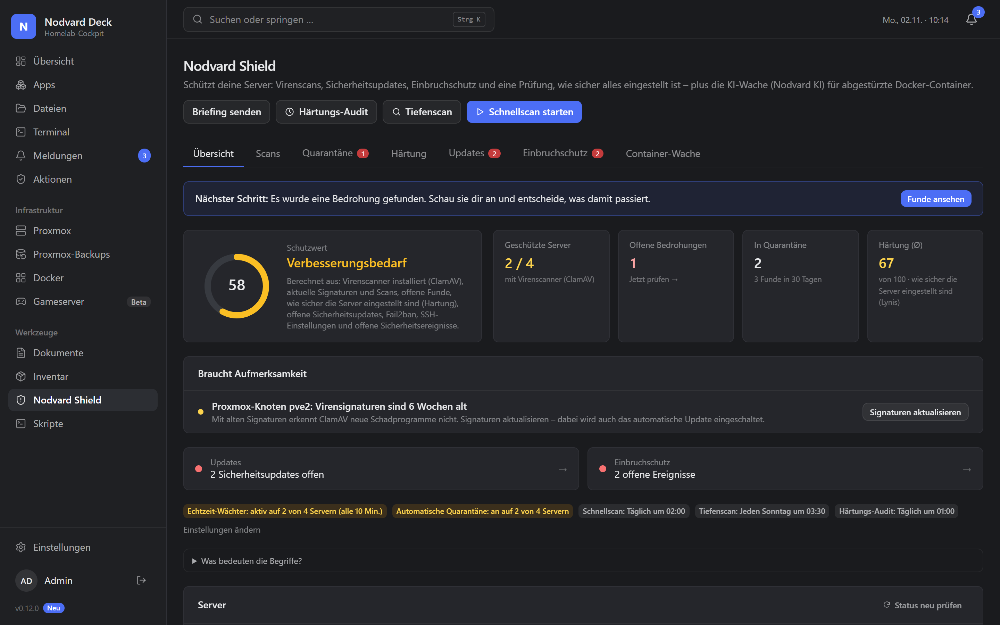
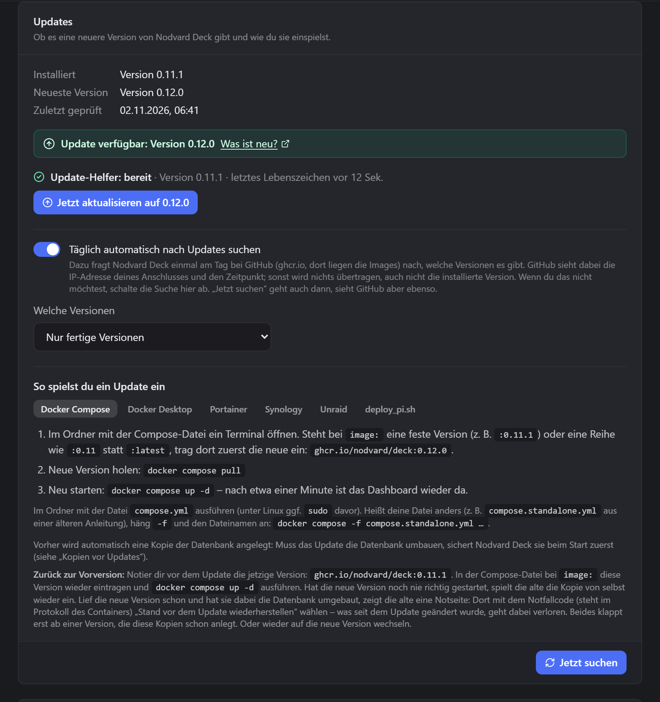

<div align="center">

# Nodvard Deck

**Ein Dashboard für dein ganzes Homelab – Server, VMs, Container, Backups, Sicherheit und mehr.**

Selbst gehostet · Quelltext einsehbar (PolyForm Noncommercial) · kostenlos für den privaten Gebrauch

[English](README.en.md) · [Dokumentation](docs/README.md) · [Loslegen](#loslegen) · [Discord](https://discord.gg/gTTs7qMabt) · [Feedback](CONTRIBUTING.md)

[](https://github.com/nodvard/deck/releases/latest)
[](LICENSE)


Die Weboberfläche gibt es derzeit nur auf Deutsch. Diese README gibt es auch auf [Englisch](README.en.md).

</div>

---

Nodvard Deck bündelt Zustand, Protokolle und Aktionen deines Homelabs in **einer Weboberfläche**, mit einem
**Freigabe-System** für Änderungen an deinen Servern. Jeder Server bekommt eine eigene Seite mit Status,
Live-Auslastung, Aktionen und Einstellungen. Was etwas verändert, startest du selbst oder gibst es über eine Freigabe
frei; die Ausnahmen stehen unter [Sicherheit und Datenschutz](#sicherheit-und-datenschutz-auf-einen-blick). Einige
Module sind noch Beta oder nur lesend (siehe die Tabellen unter [Funktionen](#funktionen)).

> **Stand:** Nodvard Deck ist in aktiver Entwicklung (Beta). Es läuft rund um die Uhr in einem
> echten Homelab, Schnittstellen und Datenformate können sich aber noch ändern.

## So sieht es aus

| Übersicht | Docker |
|---|---|
|  |  |
| **Nodvard Shield** | **Updates** |
|  |  |

Die Bilder zeigen Beispieldaten.

## Sicherheit und Datenschutz auf einen Blick

- **Keine Telemetrie:** Nodvard Deck schickt keine Nutzungs- oder Absturzdaten irgendwohin.
- **Von selbst nach außen** geht nur die Update-Suche: Einmal am Tag fragt Nodvard Deck bei GitHub nach einer neuen
  Version, GitHub sieht dabei deine IP-Adresse und den Zeitpunkt (abschaltbar, Einzelheiten in
  [docs/11, Abschnitt 10.5](docs/11-ERST-EINRICHTUNG.md#105-neue-version-finden-und-einspielen)). Alles andere geht nur
  dorthin, wo du es einrichtest: deine Server per SSH, Proxmox, Meldungskanäle wie ntfy, eine KI wie Ollama.
- **Deine Server fragen selbst nach:** Nodvard Shield lässt sie einmal am Tag ihre Paketlisten bei ihren Paketquellen
  neu laden, um Updates zu finden. Schaltest du im Modul Docker die Suche nach neuen Images ein (Standard aus), fragen
  deine Docker-Server bei den Registries ihrer Container nach.
- **Geheimnisse im Tresor:** Passwörter, Tokens und SSH-Schlüssel liegen verschlüsselt in der Datenbank, der
  Schlüssel dazu (`master.key`) im Datenordner. Wer den Datenordner hat, kommt an alles heran. Sicherungen aus der
  Oberfläche sind immer verschlüsselt (mit Passwort oder Wiederherstellungsschlüssel); `deploy/backup.sh` verschlüsselt
  nur, wenn in Nodvard Deck ein Sicherungsschlüssel eingerichtet ist, sonst enthält die Datei den Schlüssel zum Tresor.
- **Nicht direkt ins Internet stellen:** Nodvard Deck gehört ins Heimnetz oder hinter ein VPN. Hinter einem Reverse
  Proxy mit HTTPS: [docs/12-REVERSE-PROXY.md](docs/12-REVERSE-PROXY.md).
- **Rechte auf den Servern:** Die Module arbeiten per SSH. Wo root nötig ist, richtet Nodvard Deck standardmäßig eine
  enge sudo-Regel nur für seine eigenen Hilfsskripte ein, volle Rechte nur für Module ohne Hilfsskript. Das Modul
  Docker braucht die Gruppe docker, und die ist so viel wie root; wer Container nur starten, stoppen und ansehen will,
  nimmt den Modus „Nur bedienen“ ohne die Gruppe
  ([docs/11, Abschnitt 6](docs/11-ERST-EINRICHTUNG.md#6-root-rechte-ohne-passwort-und-gruppe-docker)).
- **Kein Docker-Socket im Dashboard:** Den bekommt nur der optionale Update-Helfer in seiner eigenen Compose-Datei.
- **Änderungen mit deinem Okay:** Was auf deinen Servern etwas verändert, löst du selbst aus (Riskantes mit Rückfrage)
  oder gibst es unter „Aktionen“ frei, und es steht im Protokoll. Ohne Klick läuft nur, was du ausdrücklich erlaubst:
  den Modus „Selbstständig handeln“, eine Dauerfreigabe oder automatische Updates. Ab Werk eingeschaltet ist davon nur
  die Quarantäne des Virenschutzes: Er verschiebt Funde sofort (umkehrbar, abschaltbar).

Sicherheitslücken bitte **nicht** in öffentlichen Issues melden – siehe [SECURITY.md](SECURITY.md).

## Funktionen

**Kern**
- Dashboard mit frei anordenbaren Widgets und Statusübersicht („Cockpit“)
- Serverseiten: Status, Live-CPU/RAM, Aktionen, Werkzeuge und Dienste pro Host
- Freigabe-System: Änderungen werden erst vorgeschlagen und laufen nach Freigabe (optional Autonomie-Modus, Sperrliste, Wartungsfenster)
- Benutzer, Rollen und Rechte, Zwei-Faktor-Login, Audit-Log
- Verschlüsselter Tresor für API-Tokens und SSH-Zugänge
- Web-Terminal (SSH) und Dateimanager über alle Server
- Benachrichtigungszentrale, Push-Nachrichten über ntfy
- White-Label: Name, Logo und Farben sind Einstellungen, kein Code
- Als App auf dem Handy installierbar (PWA)

**Erweiterungen** (einzeln an- und abschaltbar)

**Server und Infrastruktur**

| Erweiterung | Was sie macht |
|---|---|
| Proxmox VE (nur mit Proxmox) | Nodes, VMs und Container: Start/Stopp, Konsole im Browser, Snapshots, Hardware, Speicher, Updates, Festplatten-Zustand |
| Proxmox-Backups (nur mit Proxmox) | Alle Proxmox-Backups auf einen Blick, Backup-Jobs anlegen und bearbeiten, Warnungen bei fehlenden oder fehlgeschlagenen Backups |
| Docker | Docker-Container auf deinen Servern: Start/Stopp, Live-Logs, Details, Aufräumen, Compose-Stacks, Image-Update-Prüfung |
| Server-Zustand | Linux-Server per SSH: Betriebssystem, Last, Platten, fehlgeschlagene Dienste, ausstehende Updates |
| Nodvard Shield | Sicherheit: Virenscan (ClamAV), Härtungs-Audits (Lynis), Update-Zentrale, Einbruchserkennung, Datei-Integrität, KI-Container-Wache |
| Pi-hole (Beta) | Statistiken, Blocken pausieren und fortsetzen, Sperrlisten neu laden, Domains sperren oder erlauben |
| Nginx Proxy Manager (Beta) | Proxy-Hosts ein- und ausschalten, Zertifikatsablauf, Adress-Check zu den Containern |
| Netzwerk (Beta) | Nur noch Wegweiser zu Pi-hole und Nginx Proxy Manager; kann ausgeschaltet bleiben |
| Skripte | Versionierte Skript-Bibliothek, auf einem oder vielen Servern ausführen, zeitgesteuert – auf Wunsch ohne Klick, solange sich nichts ändert |
| ntfy | Push-Benachrichtigungen aufs Handy |

**Weitere Module**

| Erweiterung | Was sie macht |
|---|---|
| Gameserver (Beta) | Gameserver starten/stoppen und aktuellen Beitrittscode anzeigen (z. B. Valheim) |
| Dokumente | Dokumentenarchiv mit Texterkennung (OCR) und Volltextsuche |
| Inventar | Geräte und Gegenstände mit Kaufdaten und Garantie-Erinnerung |
| Nextcloud | Nextcloud als Quelle im Dateimanager, dazu eine Kachel mit Version, Updates, freiem Speicher, aktiven Nutzern und Last |
| Uptime Kuma (Beta) | Zustand aller Monitore, Verfügbarkeit der letzten 24 Stunden, letzte Ausfälle und ablaufende Zertifikate (nur lesend) |
| Home Assistant (Beta) | Version, bereitstehende Updates, nicht verfügbare Geräte und ausgewählte Werte wie Temperaturen (nur lesend) |
| Jellyfin (Beta) | Laufende Wiedergaben mit Benutzer und Gerät, ob transkodiert wird, Größe der Bibliotheken und neue Medien (nur lesend); alle mit Zugriff auf die Seite sehen auch Benutzer und Titel |
| Plex (Beta) | Laufende Wiedergaben mit Benutzer und Gerät, Größe der Bibliotheken und neue Medien; spricht nur mit deinem Server, nie mit plex.tv (nur lesend); alle mit Zugriff auf die Seite sehen auch Benutzer und Titel |
| qBittorrent (Beta) | Geschwindigkeit, aktive Torrents, Anzahl je Zustand und freier Platz (nur lesend); alle mit Zugriff auf die Seite sehen auch die Torrent-Namen |
| Synology DSM (Beta) | Modell, DSM-Version, Auslastung, Speicherpools, Volumes, Festplatten, Hyper Backup und ob ein Update bereitsteht (nur lesend); meldet, wenn etwas nicht stimmt; am besten mit einem eigenen DSM-Konto ohne Zwei-Faktor, für Speicher, Updates und Hyper Backup in der Gruppe „administrators“ |
| Vaultwarden (Beta) | Ob dein Passwort-Manager läuft, welche Version, ob er über HTTPS erreichbar ist und ob sich Fremde registrieren können; Nodvard Deck sieht nie ein Passwort (nur lesend) |

„Beta“ heißt: Die Erweiterung funktioniert, ist aber noch nicht so gründlich erprobt wie der Rest. Rückmeldungen helfen.

Du brauchst **kein Proxmox**: Ein Raspberry Pi, eine Debian-VM, ein NAS oder ein paar Docker-Hosts reichen.
Server legst du von Hand an, Auslastung, Docker-Container, Updates und Sicherheit laufen per SSH.

Erweiterungen bauen auf einem dokumentierten SDK auf – du kannst also eigene schreiben,
siehe [docs/02-EXTENSION-API.md](docs/02-EXTENSION-API.md).

## Loslegen

### Schnellstart mit Docker Compose

**Voraussetzung:** Docker mit Docker Compose. Nodvard Deck läuft auf einem Raspberry Pi 4/5 (arm64) genauso wie auf
jedem x86-64-Rechner. Es wird nichts gebaut: Das fertige Image kommt aus der GitHub-Container-Registry
(`ghcr.io/nodvard/deck`).

Das Wichtigste aus [deploy/compose.standalone.yml](deploy/compose.standalone.yml), vereinfacht; die vollständige Datei
enthält zusätzlich einen Healthcheck und eine Begrenzung der Logdatei:

```yaml
services:
  nodvard-deck:
    image: ghcr.io/nodvard/deck:latest
    restart: unless-stopped
    ports:
      - "${NODVARD_DECK_PORT:-8080}:8080"
    volumes:
      - nodvard_deck_data:/app/data
# …
volumes:
  nodvard_deck_data:
    name: nodvard-deck-data
```

Nodvard Deck ist danach auf Port 8080 erreichbar (mit `NODVARD_DECK_PORT` änderst du den Port), alle Daten liegen im
Volume `nodvard_deck_data` unter `/app/data`. Die Datei laden und starten:

```bash
mkdir ~/nodvard-deck && cd ~/nodvard-deck
curl -fsSL -o compose.yml https://raw.githubusercontent.com/nodvard/deck/main/deploy/compose.standalone.yml
docker compose up -d
```

**Windows:** Die Befehle sind für eine Linux-Shell (auch WSL oder Git Bash). In PowerShell `curl.exe`
statt `curl` schreiben und die Befehle einzeln ausführen.

- **Öffnen:** `http://<dein-server>:8080`
- **Port schon belegt?** (Meldung „port is already allocated“ oder „address already in use“): Neben die
  `compose.yml` eine Datei `.env` mit der Zeile `NODVARD_DECK_PORT=8081` legen und `docker compose up -d`
  noch einmal ausführen. Die Adresse ist dann `http://<dein-server>:8081`.
- **Einrichtungscode:** Beim ersten Start schreibt Nodvard Deck einen Einrichtungscode ins Protokoll des Containers:
  `docker compose logs nodvard-deck` im selben Ordner, die Zeile beginnt mit „Einrichtungscode“. Mit ihm legst du im
  Browser das erste Konto an, den Inhaber. So wird nicht der Erste, der die Seite aufruft, automatisch Inhaber. Der
  Code bleibt bei jedem Neustart gleich, bis das Konto angelegt ist; danach braucht es ihn nicht mehr
  ([docs/11, Abschnitt 2](docs/11-ERST-EINRICHTUNG.md#2-einrichtungsassistent-setup)).
- **Aktualisieren:** im selben Ordner `docker compose pull && docker compose up -d`. Deine Daten bleiben
  erhalten.

**Raspberry Pi:** Das Image gibt es für `linux/arm64`, du brauchst also ein **64-Bit-System** (`uname -m` zeigt
`aarch64`). Die Befehle sind dieselben, nur mit `sudo` davor (`sudo docker compose up -d`), solange dein Benutzer nicht
in der Gruppe `docker` ist. Eine SD-Karte kann sterben: Sicherungen nicht nur auf dem Pi lassen
([docs/11, Abschnitt 10](docs/11-ERST-EINRICHTUNG.md#10-das-dashboard-selbst-sichern)). Mehr dazu in der
[Anleitung für den Pi](docs/11-ERST-EINRICHTUNG.md#raspberry-pi-proxmox-und-docker-desktop).

Danach im Browser dem Einrichtungs-Assistenten folgen. Alles Weitere – Server, SSH-Zugang, Module,
Sicherung – richtest du in der Oberfläche ein.

Die komplette Schritt-für-Schritt-Anleitung (Einrichtungscode, SSH-Zugang, Proxmox-Token,
Push-Nachrichten, Sicherung von Nodvard Deck selbst, Notfall-Befehle) steht in
[docs/11-ERST-EINRICHTUNG.md](docs/11-ERST-EINRICHTUNG.md).

### Weitere Wege

Für diese Wege reicht teils Docker oder Podman allein. Jeder steht Schritt für Schritt in
[docs/11, Abschnitt 1.1](docs/11-ERST-EINRICHTUNG.md#11-installation-ohne-das-repo):

- **Im Terminal:** ein einzelner `docker run`-Befehl, Podman
  ([Anleitung](docs/11-ERST-EINRICHTUNG.md#im-terminal))
- **Mit einer Web-Oberfläche:** Portainer (aus dem Repository oder mit dem Web-Editor) und Dockge
  ([Anleitung](docs/11-ERST-EINRICHTUNG.md#mit-einer-web-oberfläche)). Im Web-Editor von Portainer gehört der
  **Inhalt** der Compose-Datei hinein, nicht die Befehle aus dem Schnellstart; sonst meldet Portainer „top-level
  object must be a mapping“.
- **Auf einem NAS:** Synology, UGREEN, QNAP, Unraid, TrueNAS SCALE, OpenMediaVault, ZimaOS und CasaOS
  ([Anleitung](docs/11-ERST-EINRICHTUNG.md#auf-einem-nas))
- **Auf bestimmten Geräten:** Raspberry Pi, Proxmox (VM oder LXC-Container) und Docker Desktop zum Ausprobieren
  ([Anleitung](docs/11-ERST-EINRICHTUNG.md#raspberry-pi-proxmox-und-docker-desktop))

**Selbst bauen** (für Entwickler): Repository klonen, dann in `deploy/` `docker compose build --pull && docker compose up -d`.
Bauen, Deployen, Sichern und Wiederherstellen: [deploy/README.md](deploy/README.md).

## Aufbau

```
backend/     FastAPI (Python 3.12), SQLAlchemy + SQLite, Alembic-Migrationen
sdk/python/  nodvard_sdk – der stabile Vertrag für Erweiterungen
frontend/    Weboberfläche mit React + Vite + TypeScript + Tailwind
extensions/  ein Ordner pro Erweiterung (Python-Backend + gebautes Frontend)
deploy/      Dockerfile, docker-compose, Backup-/Restore-Skripte
docs/        Architektur, Extension-API, Datenmodell, API-Referenz
```

Der Kern kennt keinen Hersteller beim Namen – alles Spezifische (Proxmox, Docker, Pi-hole …)
steckt in Erweiterungen. Ein Prüfskript (`scripts/check_core_purity.py`) stellt das sicher.
Mehr dazu: [docs/01-ARCHITECTURE.md](docs/01-ARCHITECTURE.md).

## Entwicklung

```bash
# Backend
python -m venv .venv
.venv/bin/pip install -c deploy/constraints.txt -e sdk/python -e "backend[dev]"
.venv/bin/pytest sdk/python/tests backend/tests
python scripts/check_core_purity.py

# Frontend (im Ordner frontend/)
npm ci
npm run typecheck && npm run typecheck:extensions
npm test && npm run test:extensions
npm run build
```

Hinweise zum Selbstbauen und Prüfen: [CONTRIBUTING.md](CONTRIBUTING.md).

## Wie getestet wird

Vor jedem Release laufen alle Tests für Backend, Frontend und Erweiterungen samt der Prüfskripte (Lizenzen, Kern
unabhängig von den Modulen, keine Geheimnisse im Code), und das Image wird zur Probe gebaut. Die veröffentlichten
Images baut und prüft danach der Release-Ablauf bei GitHub (`.github/workflows/release.yml`).

## Mitmachen

Für private und andere nicht-kommerzielle Zwecke ist Nodvard Deck kostenlos, der Quellcode ist einsehbar.

- **Pull Requests** für dieses Repository nimmt das Projekt derzeit nicht an.
- **Willkommen** sind Fehlermeldungen, Ideen und Rückmeldungen: Wie das geht, steht in
  [CONTRIBUTING.md](CONTRIBUTING.md) (auf Englisch). Fragen und Austausch gibt es im
  [Discord](https://discord.gg/gTTs7qMabt).
- **Willkommen** sind auch eigene Erweiterungen, die du über das SDK baust, siehe
  [docs/02-EXTENSION-API.md](docs/02-EXTENSION-API.md).

Nodvard Deck ist ein privates, nicht-kommerzielles Projekt.

## Deck oder Dock?

- **Nodvard Deck** ist das ganze Dashboard mit allen Modulen: Server, Proxmox, Docker, Backups, Sicherheit und mehr.
- **[Nodvard Dock](https://github.com/nodvard/dock)** ist Nodvard Deck mit nur dem Modul Docker: derselbe Code, nur
  weniger drin. Nimm Dock, wenn du nur die Container und Stacks auf deinen Servern verwalten willst.

## Lizenz

Nodvard Deck steht unter der **PolyForm Noncommercial License 1.0.0** – siehe [LICENSE](LICENSE).
Kurz gesagt (verbindlich ist nur der Lizenztext): Du darfst Nodvard Deck für private und andere
nicht-kommerzielle Zwecke nutzen, den Quellcode lesen und für dich anpassen. Kommerzielle
Nutzung, zum Beispiel in einem Unternehmen oder als bezahlter Dienst, ist ohne gesonderte Erlaubnis
nicht gestattet. Anfragen: **kontakt@nodvard.com**. Der Quellcode ist damit einsehbar, Nodvard Deck ist aber keine
Open-Source-Software im engeren Sinn. Die Lizenzen der mitgelieferten Bibliotheken stehen in
[THIRD_PARTY_LICENSES](THIRD_PARTY_LICENSES).

**Warum keine Open-Source-Lizenz?** Nodvard Deck entsteht als Projekt eines Einzelnen, und die Lizenz soll verhindern,
dass jemand es ohne Absprache als eigenes Produkt oder bezahlten Dienst verkauft. Der Quelltext bleibt trotzdem offen
lesbar: Du kannst nachsehen, was das Programm auf deinen Servern tut, es für dich anpassen und Fehler melden. Wer es in
einem Unternehmen oder kommerziell nutzen möchte, fragt einfach unter **kontakt@nodvard.com** nach.

## Marken

Proxmox, Docker, Portainer, Synology, Unraid, Nextcloud, Pi-hole, Nginx Proxy Manager, ntfy, Ollama, ClamAV, Lynis,
Fail2ban, Raspberry Pi und andere genannte Namen sind Marken ihrer jeweiligen Inhaber. Nodvard Deck steht in keiner Verbindung zu ihnen.

© 2026 Nico Benks
