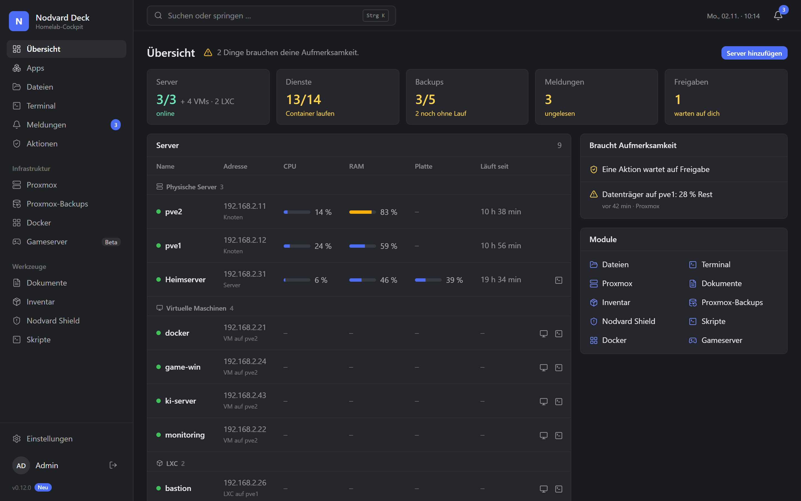
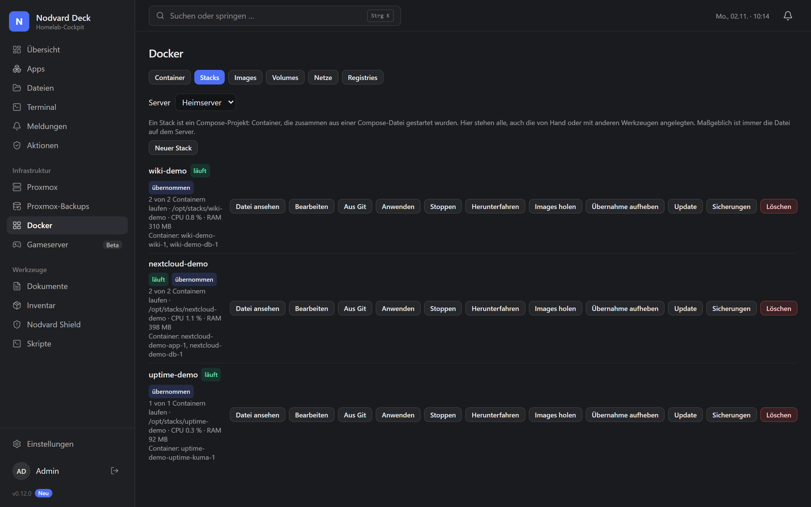
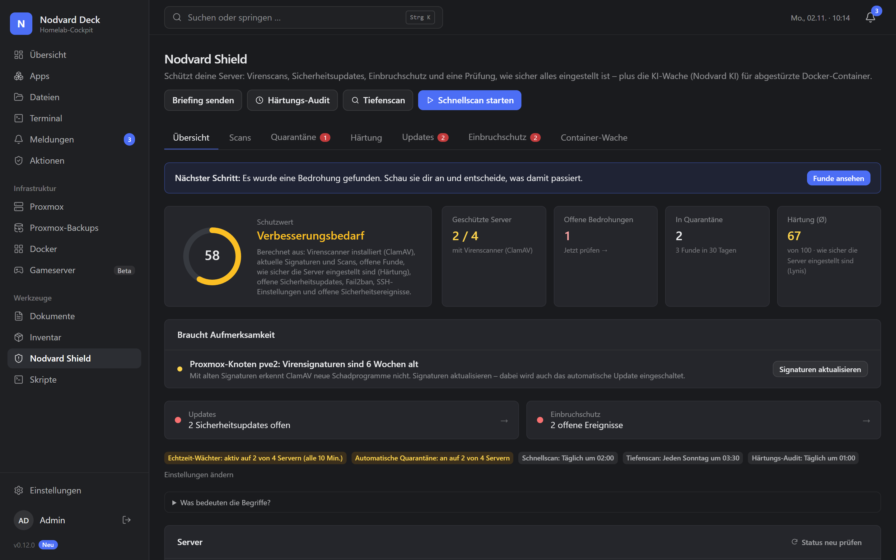
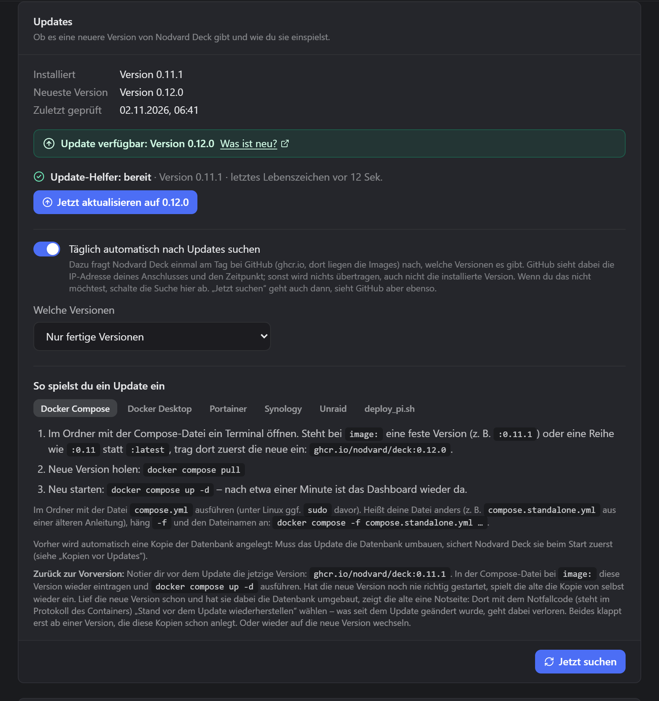

<div align="center">

# Nodvard Deck

Self-hosted, Quelltext einsehbar (PolyForm Noncommercial), kostenlos für private Nutzung

**Ein Dashboard für dein ganzes Homelab: Server, VMs, Container, Backups und Systemzustand an einem Ort.**

[English](README.en.md) · [Dokumentation](docs/README.md) · [Schnellstart](#schnellstart-in-5-minuten) · [Discord](https://discord.gg/gTTs7qMabt) · [Feedback](CONTRIBUTING.md)

[](https://github.com/nodvard/deck/releases/latest)
[](LICENSE)


Die Weboberfläche gibt es derzeit nur auf Deutsch. Diese README gibt es auch auf [Englisch](README.en.md).

</div>

---

Nodvard Deck bündelt Zustand, Protokolle und Aktionen deines Homelabs in einer Weboberfläche.
Jeder Server bekommt eine eigene Seite mit Status, Live-Auslastung, Aktionen und Einstellungen.
Was etwas verändert, startest du selbst oder gibst es unter „Aktionen“ frei. Die Ausnahmen stehen unter
[Sicherheit und Datenschutz](#sicherheit-und-datenschutz-auf-einen-blick). Einige
Module sind noch Beta oder nur lesend (siehe die Tabellen unter [Funktionen](#funktionen)).

> **Stand:** Nodvard Deck ist in aktiver Entwicklung (Beta). Es läuft rund um die Uhr in einem
> echten Homelab, Schnittstellen und Datenformate können sich aber noch ändern.

## Warum eine nichtkommerzielle Lizenz?

Nodvard Deck entsteht bei einem Einzelentwickler, der mit PolyForm Noncommercial die kommerzielle Vermarktung ohne Absprache verhindern möchte und den Quelltext vollständig lesbar hält.
Du darfst Deck für private und andere nichtkommerzielle Zwecke nutzen, verändern und unter den Bedingungen von [LICENSE](LICENSE) weitergeben; kommerzielle Nutzung und Vermarktung sind ohne gesonderte Erlaubnis verboten.
Für Ausnahmen erreichst du den Entwickler unter **kontakt@nodvard.com** oder im [Discord](https://discord.gg/gTTs7qMabt).

## Was Deck kann und was nicht

- **Ein gemeinsamer Blick aufs Homelab:** Zustand, Protokolle und Aktionen unterstützter Dienste an einem Ort; zusätzliche Dienste brauchen eine passende Erweiterung.
- **Mit oder ohne Proxmox:** Linux-Server lassen sich per SSH anbinden; Deck installiert weder Docker noch deine Anwendungen für dich.
- **Rechte bleiben echte Rechte:** Ein SSH-Zugang ist nötig, manche Funktionen brauchen Root-Rechte oder die praktisch gleich mächtige Gruppe `docker`.
- **Du steuerst Änderungen:** Aktionen lassen sich freigeben und protokollieren; aktivierte Automatik und die standardmäßig eingeschaltete Virenquarantäne können ohne weiteren Klick handeln.
- **Sicherheitshilfen mit Grenzen:** Scans, Audits und Warnungen helfen beim Prüfen; sie garantieren weder einen sicheren Server noch die Erkennung jedes Angriffs.
- **Sicherungen brauchen einen zweiten Ort:** Deck kann seine Daten verschlüsselt sichern; eine Sicherung im selben Volume schützt nicht vor dem Ausfall dieses Datenträgers.
- **Beta im privaten Betrieb:** Deck wird in einem Homelab rund um die Uhr genutzt, bietet aber keine garantierte Verfügbarkeit und keinen 24/7-Support; Datenformate können sich ändern und manche Module lesen nur.
- **Die Oberfläche spricht Deutsch:** Die Dokumentation gibt es auch auf Englisch; eine englische Bedienoberfläche gibt es derzeit nicht.

## So sieht es aus

| Übersicht | Docker |
|---|---|
| [](docs/img/uebersicht.png) | [](docs/img/docker.png) |
| **Nodvard Shield** | **Updates** |
| [](docs/img/shield.png) | [](docs/img/updates.png) |

Die Bilder zeigen Beispieldaten. Klicke auf ein Bild für die vergrößerte Ansicht.

## Funktionen

**Kern**
- Dashboard mit frei anordenbaren Widgets und Statusübersicht („Cockpit“)
- Serverseiten: Status, Live-CPU/RAM, Aktionen, Werkzeuge und Dienste pro Host
- Freigabe-System: Änderungen werden erst vorgeschlagen und laufen nach Freigabe (optional Autonomie-Modus, Sperrliste, Wartungsfenster)
- Benutzer, Rollen und Rechte, Zwei-Faktor-Login, Audit-Log
- Verschlüsselter Tresor für API-Tokens und SSH-Zugänge
- Web-Terminal (SSH) und Dateimanager über alle Server
- Benachrichtigungszentrale, Push-Nachrichten über ntfy
- White-Label: Name, Logo und Farben sind Einstellungen, kein Code
- Als App auf dem Handy installierbar (PWA)

**Erweiterungen** (einzeln an- und abschaltbar)

**Server und Infrastruktur**

| Erweiterung | Was sie macht |
|---|---|
| Proxmox VE (nur mit Proxmox) | Nodes, VMs und Container: Start/Stopp, Konsole im Browser, Snapshots, Hardware, Speicher, Updates, Festplatten-Zustand |
| Proxmox-Backups (nur mit Proxmox) | Alle Proxmox-Backups auf einen Blick, Backup-Jobs anlegen und bearbeiten, Warnungen bei fehlenden oder fehlgeschlagenen Backups |
| Docker | Docker-Container auf deinen Servern: Start/Stopp, Live-Logs, Details, Aufräumen, Compose-Stacks, Image-Update-Prüfung |
| Server-Zustand | Linux-Server per SSH: Betriebssystem, Last, Platten, fehlgeschlagene Dienste, ausstehende Updates |
| Nodvard Shield | Sicherheit: Virenscan (ClamAV), Härtungs-Audits (Lynis), Update-Zentrale, Einbruchserkennung, Datei-Integrität, Container-Wache |
| Pi-hole (Beta) | Statistiken, Blocken pausieren und fortsetzen, Sperrlisten neu laden, Domains sperren oder erlauben |
| Nginx Proxy Manager (Beta) | Proxy-Hosts ein- und ausschalten, Zertifikatsablauf, Adress-Check zu den Containern |
| Skripte | Versionierte Skript-Bibliothek, auf einem oder vielen Servern ausführen, zeitgesteuert, auf Wunsch ohne Klick, solange sich nichts ändert |
| Push-Nachrichten | Push-Benachrichtigungen über ntfy und weitere Kanäle |

**Weitere Module**

| Erweiterung | Was sie macht |
|---|---|
| Gameserver (Beta) | Gameserver starten/stoppen und aktuellen Beitrittscode anzeigen (z. B. Valheim) |
| Dokumente | Dokumentenarchiv mit Texterkennung (OCR) und Volltextsuche |
| Inventar | Geräte und Gegenstände mit Kaufdaten und Garantie-Erinnerung |
| Nextcloud | Nextcloud als Quelle im Dateimanager, dazu eine Kachel mit Version, Updates, freiem Speicher, aktiven Nutzern und Last |
| Uptime Kuma (Beta) | Zustand aller Monitore, Verfügbarkeit der letzten 24 Stunden, letzte Ausfälle und ablaufende Zertifikate (nur lesend) |
| Home Assistant (Beta) | Version, bereitstehende Updates, nicht verfügbare Geräte und ausgewählte Werte wie Temperaturen (nur lesend) |
| Jellyfin (Beta) | Laufende Wiedergaben mit Benutzer und Gerät, ob transkodiert wird, Größe der Bibliotheken und neue Medien (nur lesend); alle mit Zugriff auf die Seite sehen auch Benutzer und Titel |
| Plex (Beta) | Laufende Wiedergaben mit Benutzer und Gerät, Größe der Bibliotheken und neue Medien; spricht nur mit deinem Server, nie mit plex.tv (nur lesend); alle mit Zugriff auf die Seite sehen auch Benutzer und Titel |
| qBittorrent (Beta) | Geschwindigkeit, aktive Torrents, Anzahl je Zustand und freier Platz (nur lesend); alle mit Zugriff auf die Seite sehen auch die Torrent-Namen |
| Synology DSM (Beta) | Modell, DSM-Version, Auslastung, Speicherpools, Volumes, Festplatten, Hyper Backup und ob ein Update bereitsteht (nur lesend); meldet, wenn etwas nicht stimmt; am besten mit einem eigenen DSM-Konto ohne Zwei-Faktor, für Speicher, Updates und Hyper Backup in der Gruppe „administrators“ |
| Vaultwarden (Beta) | Ob dein Passwort-Manager läuft, welche Version, ob er über HTTPS erreichbar ist und ob sich Fremde registrieren können; Nodvard Deck sieht nie ein Passwort (nur lesend) |

„Beta“ heißt: Die Erweiterung funktioniert, ist aber noch nicht so gründlich erprobt wie der Rest. Rückmeldungen helfen.

Du brauchst **kein Proxmox**: Ein Raspberry Pi, eine Debian-VM, ein NAS oder ein paar Docker-Hosts reichen.
Server legst du von Hand an, Auslastung, Docker-Container, Updates und Sicherheit laufen per SSH.

Erweiterungen bauen auf einem dokumentierten SDK auf. Du kannst also eigene schreiben,
siehe [docs/02-EXTENSION-API.md](docs/02-EXTENSION-API.md).
Das ausführbare Beispiel `hello-world` bleibt dort als Vorlage erklärt und wird nicht standardmäßig mitgeliefert.
Der frühere [Netzwerk-Wegweiser](extensions/network/extension.toml) zu Pi-hole und Nginx Proxy Manager bleibt
ebenfalls im Quellbaum für eigene Builds, gehört aber nicht mehr zum Standardimage.
Vor einem Update beide Module ausschalten, falls sie noch aktiv sind: [Hinweise zum Bauen](deploy/README.md#bauen).

## Schnellstart in 5 Minuten

### Starten mit Docker Compose

**Voraussetzung:** Docker mit Docker Compose. Nodvard Deck läuft auf einem Raspberry Pi 4/5 (arm64) genauso wie auf
jedem x86-64-Rechner. Es wird nichts gebaut: Das fertige Image kommt aus der GitHub-Container-Registry
(`ghcr.io/nodvard/deck`).

Die fünf Minuten sind ein Richtwert bei vorhandenem Docker, Docker Compose und einem erreichbaren Linux-Server mit SSH-Zugang.
Der erste Image-Download oder die Einrichtung auf dem Server kann länger dauern.

1. **Deck starten:** Die Datei laden und im selben Ordner starten:

```bash
mkdir ~/nodvard-deck && cd ~/nodvard-deck
curl -fsSL -o compose.yml https://raw.githubusercontent.com/nodvard/deck/main/deploy/compose.standalone.yml
docker compose up -d
```

Nodvard Deck ist danach auf Port 8080 erreichbar (mit `NODVARD_DECK_PORT` änderst du den Port). Alle Daten liegen im
Docker-Speicher (Volume) `nodvard-deck-data`, im Container unter `/app/data`. Die vollständige Datei steht unter
[deploy/compose.standalone.yml](deploy/compose.standalone.yml).

2. **Erster Login:** `http://localhost:8080` oder `http://<Adresse-des-Rechners>:8080` öffnen und mit
   `docker compose logs nodvard-deck` den **Einrichtungscode** holen. Im Assistenten ein eigenes Inhaber-Konto
   mit Benutzername und Passwort anlegen; es gibt kein Standardpasswort. Mit diesem Konto meldest du dich künftig an
   ([Einrichtung, Abschnitt 2](docs/11-ERST-EINRICHTUNG.md#2-einrichtungsassistent-setup)).
3. **Ersten Server anbinden:** Unter **Einstellungen → Server & Zugänge → Server hinzufügen** Name und Adresse
   eintragen, SSH-Schlüssel erzeugen, den angezeigten Einrichtungsbefehl auf dem Zielserver ausführen und
   **Verbindung prüfen** drücken. Den angezeigten Server-Schlüssel vor dem Bestätigen vergleichen
   ([Einrichtung, Abschnitt 3](docs/11-ERST-EINRICHTUNG.md#3-den-ersten-server-verbinden)).
4. **Erstes Modul ansehen:** Unter **Einstellungen → Erweiterungen** das Modul **Server-Zustand** einschalten und
   die Seite des verbundenen Servers öffnen. Beginne mit den lesenden Statuswerten; für Dienste-Neustarts sind
   zusätzliche Rechte nötig ([Einrichtung, Abschnitt 4](docs/11-ERST-EINRICHTUNG.md#4-erweiterungen-einschalten)).

**Windows:** Die Befehle sind für eine Linux-Shell (auch WSL oder Git Bash). In PowerShell `curl.exe`
statt `curl` schreiben und die Befehle einzeln ausführen.

- **Öffnen:** `http://<Adresse-des-Rechners>:8080`, zum Beispiel `http://192.168.1.10:8080`. Auf demselben Rechner geht auch `http://localhost:8080`.
- **Port schon belegt?** (Meldung „port is already allocated“ oder „address already in use“): Neben die
  `compose.yml` eine Datei `.env` mit der Zeile `NODVARD_DECK_PORT=8081` legen und `docker compose up -d`
  noch einmal ausführen. Die Adresse ist dann `http://<Adresse-des-Rechners>:8081`.
- **Einrichtungscode:** Die Zeile im Protokoll beginnt mit „Einrichtungscode“. Der Code bleibt über Neustarts
  gleich, bis das Inhaber-Konto angelegt ist; danach braucht es ihn nicht mehr.
- **Aktualisieren:** im selben Ordner `docker compose pull && docker compose up -d`. Deine Daten bleiben
  erhalten.

<details>
<summary><b>Portainer, Weg 1: aus dem Repository</b></summary>

1. **Stacks → Add stack**, Name z. B. `nodvard-deck` (nur Kleinbuchstaben, Ziffern, `-` und `_`).
2. Als Aufbau **Repository** wählen und eintragen:
   - **Repository URL:** `https://github.com/nodvard/deck`
   - **Repository reference:** `refs/heads/main`
   - **Compose path:** `deploy/compose.standalone.yml`

   Eine Anmeldung brauchst du nicht, das Repository ist öffentlich.
3. **Deploy the stack**.

- **Öffnen:** `http://<dein-server>:8080`
- **Port schon belegt?** Unter **Environment variables** die Variable `NODVARD_DECK_PORT` mit z. B. `8081`
  anlegen, beim neuen Stack vor „Deploy the stack“, beim bestehenden danach neu ausrollen
  („Pull and redeploy“). Die Adresse ist dann `http://<dein-server>:8081`.
- **Einrichtungscode:** **Containers** → `nodvard-deck-nodvard-deck-1` (allgemein
  `<Stack-Name>-nodvard-deck-1`) → **Logs**, die Zeile beginnt mit „Einrichtungscode“.
- **Aktualisieren:** im Stack **Pull and redeploy** mit eingeschaltetem **Re-pull image**. Die
  automatischen Updates von Portainer („Automatic updates“, in neueren Versionen „GitOps updates“) kannst
  du optional einschalten: Sie übernehmen Änderungen an der Compose-Datei im Repository von selbst. Eine
  neue Version von Nodvard Deck ist aber ein neues Image und keine Änderung an der Datei; die holst du
  mit „Pull and redeploy“.

</details>

<details>
<summary><b>Portainer, Weg 2: Web-Editor</b></summary>

1. Die Datei [deploy/compose.standalone.yml](deploy/compose.standalone.yml) öffnen
   ([als reiner Text](https://raw.githubusercontent.com/nodvard/deck/main/deploy/compose.standalone.yml))
   und ihren **ganzen Inhalt** kopieren. Er beginnt mit `# Nodvard Deck ohne das Repository installieren`
   und enthält weiter unten `services:`.
2. **Stacks → Add stack**, Name z. B. `nodvard-deck`, als Aufbau **Web editor**, den Inhalt einfügen,
   **Deploy the stack**.

**Nicht** die drei Befehle aus dem Terminal-Weg (`mkdir …`, `curl …`, `docker compose up -d`) einfügen.
Das sind Befehle für die Shell, keine Compose-Datei; Portainer meldet dann „top-level object must be a
mapping“.

- **Öffnen:** `http://<dein-server>:8080`
- **Port schon belegt?** Unter **Environment variables** die Variable `NODVARD_DECK_PORT` mit z. B. `8081`
  anlegen, beim neuen Stack vor „Deploy the stack“, beim bestehenden danach „Update the stack“. Die
  Adresse ist dann `http://<dein-server>:8081`.
- **Einrichtungscode:** **Containers** → `nodvard-deck-nodvard-deck-1` (allgemein
  `<Stack-Name>-nodvard-deck-1`) → **Logs**, die Zeile beginnt mit „Einrichtungscode“.
- **Aktualisieren:** Stack öffnen → **Editor** → **Update the stack** mit eingeschaltetem
  **Re-pull image and redeploy**. Am Inhalt im Editor musst du dafür nichts ändern.

</details>

<details>
<summary><b>Raspberry Pi</b></summary>

- Ein Raspberry Pi 4 oder 5 mit 4 GB RAM und einem **64-Bit-System** (`uname -m` zeigt `aarch64`); das
  Image gibt es für `linux/arm64`. Im Leerlauf braucht Nodvard Deck rund 100 MB Arbeitsspeicher, das Image
  ist knapp 400 MB groß. Docker mit Docker Compose muss installiert sein.
- Eine SD-Karte kann sterben: Sicherungen nicht nur auf dem Pi lassen
  ([docs/11, Abschnitt 6](docs/11-ERST-EINRICHTUNG.md#6-das-dashboard-selbst-sichern)); eine USB-SSD
  hält länger als eine SD-Karte.
- Läuft auf dem Pi Portainer, gelten die beiden Portainer-Wege oben genauso.

```bash
mkdir ~/nodvard-deck && cd ~/nodvard-deck
curl -fsSL -o compose.yml https://raw.githubusercontent.com/nodvard/deck/main/deploy/compose.standalone.yml
sudo docker compose up -d
```

Ist dein Benutzer in der Gruppe `docker`, lässt du `sudo` weg. Der erste Start dauert etwas, weil das
Image erst geladen wird.

- **Öffnen:** `http://<adresse-des-pi>:8080`
- **Port schon belegt?** Neben die `compose.yml` eine Datei `.env` mit der Zeile `NODVARD_DECK_PORT=8081`
  legen und `sudo docker compose up -d` noch einmal ausführen. Die Adresse ist dann
  `http://<adresse-des-pi>:8081`.
- **Einrichtungscode:** `sudo docker compose logs nodvard-deck` im selben Ordner, die Zeile beginnt mit
  „Einrichtungscode“.
- **Aktualisieren:** im selben Ordner `sudo docker compose pull && sudo docker compose up -d`. Deine Daten
  bleiben erhalten.

</details>

### Weitere Wege

Jeweils Schritt für Schritt in
[docs/13, Installation je Plattform](docs/13-INSTALLATION.md):

- **Im Terminal:** ein einzelner `docker run`-Befehl, Podman
  ([Anleitung](docs/13-INSTALLATION.md#im-terminal))
- **Mit einer Web-Oberfläche:** Dockge ([Anleitung](docs/13-INSTALLATION.md#mit-einer-web-oberfläche))
- **Auf einem NAS:** Synology, UGREEN, QNAP, Unraid, TrueNAS SCALE, OpenMediaVault, ZimaOS und CasaOS
  ([Anleitung](docs/13-INSTALLATION.md#auf-einem-nas))
- **Auf bestimmten Geräten:** Proxmox (VM oder LXC-Container) und Docker Desktop zum Ausprobieren
  ([Anleitung](docs/13-INSTALLATION.md#raspberry-pi-proxmox-und-docker-desktop))

Folge danach dem Einrichtungsassistenten im Browser. Server, SSH-Zugang, Module und die Sicherung richtest du in der Weboberfläche ein.

Die komplette Schritt-für-Schritt-Anleitung (Einrichtungscode, SSH-Zugang, Proxmox-Token,
Push-Nachrichten, Sicherung von Nodvard Deck selbst, Notfall-Befehle) steht in
[docs/11-ERST-EINRICHTUNG.md](docs/11-ERST-EINRICHTUNG.md).

**Selbst bauen** (für Entwickler): Repository klonen, dann in `deploy/` `docker compose build --pull && docker compose up -d`.
Bauen, Deployen, Sichern und Wiederherstellen: [deploy/README.md](deploy/README.md).

## Sicherheit und Datenschutz auf einen Blick

- **Keine Telemetrie:** Ohne Zustimmung sendet Deck keine Nutzungs- oder Absturzdaten an Nodvard
  oder einen Analysedienst. Die Netzverbindungen dienen den unten genannten Funktionen; nachprüfbar in den
  [Backend-Abhängigkeiten](backend/pyproject.toml), [Frontend-Abhängigkeiten](frontend/package.json),
  dem [Frontend-Einstieg](frontend/src/main.tsx) und den unten verlinkten Verbindungsimplementierungen.
- **Freiwillige Nutzungsdaten:** Drei einzeln wählbare Stufen, standardmäßig aus. Ohne Zustimmung wird nichts gesendet.
  Vorschau des echten JSON, lokales Protokoll und Löschknopf stehen unter Einstellungen → Nutzungsdaten.
  Bis Empfänger und Datenschutzfreigabe konfiguriert sind, bleibt das Teilen gesperrt
  ([Daten und Versand](docs/18-NUTZUNGSDATEN.md), [Datenformat](docs/04-API.md#nutzungsdaten)).
- **Deck selbst sucht nach Updates:** Einmal am Tag fragt Nodvard Deck bei `ghcr.io` nach einer neuen
  Version. Es lädt außerdem die Release-Freigabe und ihre Signatur von `github.com`, mit möglichen Weiterleitungen
  zu `objects.githubusercontent.com` oder `release-assets.githubusercontent.com`. Diese Server sehen dabei deine
  IP-Adresse und den Zeitpunkt (abschaltbar, Einzelheiten in
  [docs/11, Abschnitt I.1](docs/11-ERST-EINRICHTUNG.md#105-neue-version-finden-und-einspielen)). Die tägliche Suche
  ist standardmäßig an, ein Update wird dadurch nicht installiert
  ([Zeitplan und Schalter](backend/src/nodvard_deck/services/update_check.py),
  [Ziele und Signaturprüfung](backend/src/nodvard_deck/core/updates.py)).
- **Eingerichtete Verbindungen:** Deck spricht per SSH oder API mit deinen eingetragenen Servern und Diensten.
  Eigene App-Kacheln speichern nur Links; Deck baut keine automatischen Verbindungen zu ihren Zieladressen auf
  ([Eigene App-Links](backend/src/nodvard_deck/services/custom_apps.py)). Sprachmodell-Anbieter sind optional:
  Die vorhandene Ollama-Anbindung kontaktiert nur eingetragene Haupt- oder Ersatzserver und übermittelt dabei
  Anfragen, Servernamen und für die Container-Analyse auch Protokollauszüge; ohne eingerichtete Adresse kein Aufruf
  ([Ollama-Anbindung](extensions/shield/src/nodvard_deck_ext_shield/ollama.py),
  [Zusammenstellung der Anfragen](extensions/shield/src/nodvard_deck_ext_shield/__init__.py)).
- **Deine Server fragen selbst nach:** Nodvard Shield lässt sie einmal am Tag ihre Paketlisten bei ihren Paketquellen
  neu laden, um Updates zu finden. Schaltest du im Modul Docker die Suche nach neuen Images ein (Standard aus), fragen
  deine Docker-Server bei den Registries ihrer Container nach. Für Docker-Stacks aus Git baut Nodvard Deck außerdem
  ausgehende Git-Verbindungen zum eingerichteten Repository-Server auf
  ([Paketlisten](extensions/shield/src/nodvard_deck_ext_shield/updates.py),
  [Image-Prüfung](extensions/docker/src/nodvard_deck_ext_docker/image_updates.py),
  [Git-Abruf](extensions/docker/src/nodvard_deck_ext_docker/git_fetch.py)). Beim Installieren von Updates oder Images
  laden die Zielserver die Pakete bzw. Images nach; ClamAV lädt dort seine Signaturen
  ([Werkzeuge und Signaturen](extensions/shield/src/nodvard_deck_ext_shield/antivirus.py)).
- **Push-Nachrichten können dein Netz verlassen:** Wenn du sie im Modul „Push-Nachrichten“ einrichtest, erhalten
  die gewählten Dienste wie Discord, Telegram, Slack, Pushover und ntfy.sh die Inhalte der Benachrichtigungen.
  ntfy und Matrix können auch auf eigenen Servern laufen. Öffentliche ntfy.sh-Themen ohne
  Token-Schutz kann jeder lesen, der den Namen des Themas kennt
  ([ntfy-Versand](extensions/ntfy/src/nodvard_deck_ext_ntfy/__init__.py),
  [weitere Kanäle](extensions/ntfy/src/nodvard_deck_ext_ntfy/channels.py)).
- **Geheimnisse im Tresor:** Passwörter, Tokens und SSH-Schlüssel liegen verschlüsselt in der Datenbank.
  Die Schlüssel liegen standardmäßig unter `/app/data/master.key` und `/app/data/vault_keyring.json` im Container;
  der Keyring enthält auch neue Schlüsselversionen nach einer Rotation. Unter Linux werden beide Dateien mit
  Rechten `0600` angelegt. Wer Datenbank und Schlüsseldateien hat, kann die Geheimnisse entschlüsseln
  ([Pfade](backend/src/nodvard_deck/config.py), [Verschlüsselung und Rotation](backend/src/nodvard_deck/core/vault.py),
  [Daten-Volume](deploy/compose.standalone.yml)). Sicherungen aus der
  Oberfläche sind immer verschlüsselt (mit Passwort oder Wiederherstellungsschlüssel); `deploy/backup.sh` verschlüsselt
  nur, wenn in Nodvard Deck ein Sicherungsschlüssel eingerichtet ist, sonst enthält die Datei den Schlüssel zum Tresor.
- **Nicht direkt ins Internet stellen:** Nodvard Deck gehört ins Heimnetz oder hinter ein VPN. Hinter einem Reverse
  Proxy mit HTTPS: [docs/12-REVERSE-PROXY.md](docs/12-REVERSE-PROXY.md).
- **Rechte auf den Servern:** Die SSH-Module arbeiten mit deinem Serverzugang. Wo Root nötig ist, richtet Nodvard Deck standardmäßig enge
  sudo-Regeln nur für seine Hilfsskripte ein. Volle Rechte gibt es nur für Module ohne Hilfsskript. Für das Modul
  Docker ist die Gruppe docker so viel wie root. Wer Container nur starten, stoppen und ansehen will, nimmt den Modus
  „Nur bedienen“, ohne diese Gruppe
  ([docs/11, Anhang F](docs/11-ERST-EINRICHTUNG.md#6-root-rechte-ohne-passwort-und-gruppe-docker)).
- **Kein Docker-Socket im Dashboard:** Den bekommt nur der optionale Update-Helfer in seiner eigenen Compose-Datei.
- **Änderungen mit deinem Okay:** Was auf deinen Servern etwas verändert, löst du selbst aus (Riskantes mit Rückfrage)
  oder gibst es unter „Aktionen“ frei, und es steht im Protokoll. Ohne Klick läuft nur, was du ausdrücklich erlaubst:
  den Modus „Selbstständig handeln“, eine Dauerfreigabe oder automatische Updates. Ab Werk eingeschaltet ist davon nur
  die Quarantäne des Virenschutzes: Er verschiebt Funde sofort (umkehrbar, abschaltbar).

### Welche Zugänge die Module brauchen

Die Tabelle nennt Rechte auf den Zielsystemen. Die verlinkten Manifeste zeigen zusätzlich die Deck-internen
Modulrechte wie `hosts.execute`, `net.outbound` und den erlaubten Tresorzugriff. Ein lesendes Modul kann einen
Zugang mit weitreichenden Rechten benötigen. In Deck begrenzen Benutzerrollen den Zugriff auf Seiten und Aktionen
([Rollenprüfung](backend/src/nodvard_deck/core/rbac.py)).

| Modul mit Rechten im Code | Zugang und Grenze |
|---|---|
| [Server-Zustand](extensions/system/extension.toml) | SSH zum Lesen; Dienste-Neustarts über `sudo` und das Hilfsskript `system-root`. |
| [Nodvard Shield](extensions/shield/extension.toml) | SSH; Scans nur auf lesbaren Dateien, für vollständige Prüfungen, Updates und Quarantäne Root-Rechte über `sudo` und `shield-root`; Container-Wache zusätzlich mit Docker-Zugriff. |
| [Docker](extensions/docker/extension.toml) | SSH und Gruppe `docker` für volle Funktionen, praktisch Root-Rechte; „Nur bedienen“ nutzt `sudo` mit `docker-root` ohne diese Gruppe und erlaubt keine Stack- oder Image-Verwaltung. |
| [Terminal](extensions/terminal/extension.toml), [Skripte](extensions/scripts/extension.toml) | SSH; Befehle und Dateizugriffe haben die Rechte des angemeldeten Benutzers. Skripte benötigen je nach Inhalt zusätzliche Rechte. |
| [Gameserver](extensions/gameserver/extension.toml) | SSH mit den Rechten für die im Profil hinterlegten Start-, Stopp- und Sicherungsbefehle. |
| [Inventar](extensions/inventory/extension.toml) | Manuelle Einträge ohne Serverzugang; Hardware-Auslesen über SSH. |
| [Proxmox VE](extensions/proxmox/extension.toml), [Proxmox-Backups](extensions/backups/extension.toml) | Eigene API-Tokens mit Lese- bzw. Aktionsrechten; SSH nur für zusätzliche Serverfunktionen. Getrennte Rollen für Lesen, Steuern und Backups: [Rechte je API-Aufruf](docs/10-PROXMOX-TOKEN.md). |
| [Pi-hole](extensions/pihole/extension.toml) | API-Passwort für Statistiken und die angebotenen Änderungen. |
| [Nginx Proxy Manager](extensions/npm/extension.toml) | Konto mit Zugriff auf die Proxy-Hosts; Einschalten und Ausschalten sind Änderungen. |
| [Nextcloud](extensions/nextcloud/extension.toml) | App-Passwort mit den Dateirechten des Kontos; Kennzahlen mit separatem Serverinfo-Token oder Admin-App-Passwort. |
| [Home Assistant](extensions/home-assistant/extension.toml) | Langlebiges Token eines eigenen Benutzers ohne Admin-Rechte genügt; Deck liest nur. |
| [Jellyfin](extensions/jellyfin/extension.toml) | API-Schlüssel mit Verwaltungsrechten, von Jellyfin nicht auf Lesen begrenzbar; Deck liest nur. |
| [Plex](extensions/plex/extension.toml) | Token mit den vollen Kontorechten, nicht auf Lesen begrenzbar; Deck liest nur vom eigenen Server. |
| [qBittorrent](extensions/qbittorrent/extension.toml) | WebUI-Konto, außer die WebUI erlaubt dem Netz Zugriff ohne Anmeldung; Deck liest nur. |
| [Synology DSM](extensions/synology/extension.toml) | Eigenes DSM-Konto ohne Zwei-Faktor; Speicher, Updates und Hyper Backup brauchen meist `administrators`, obwohl Deck nur liest. |
| [Uptime Kuma](extensions/uptime-kuma/extension.toml) | API-Schlüssel zum Lesen der Monitore; optional öffentliche Status-Seite für Verlauf. |
| [Vaultwarden](extensions/vaultwarden/extension.toml) | Öffentliche Status- und Konfigurationsabfragen, kein Admin-Token und kein Zugriff auf Passwörter. |
| [Push-Nachrichten](extensions/ntfy/extension.toml) | Schreibzugang zum eingerichteten Thema, Kanal oder Raum, je Dienst per Token oder Webhook. |
| [Dokumente](extensions/documents/extension.toml) | Kein zusätzlicher Zugang zu Zielservern; speichert und verarbeitet Dateien lokal. |

Die API-Zugänge stehen im Detail in den `settings.schema.json` neben den Manifesten; die SSH-Rechte und
Hilfsskripte in [Root-Rechte](docs/14-ROOT-RECHTE.md) und im
[Einrichtungsdienst](backend/src/nodvard_deck/services/host_setup.py).

Sicherheitslücken bitte **nicht** in öffentlichen Issues melden. Siehe [SECURITY.md](SECURITY.md).

## Aufbau

```
backend/     FastAPI (Python 3.12), SQLAlchemy + SQLite, Alembic-Migrationen
sdk/python/  nodvard_sdk, der stabile Vertrag für Erweiterungen
frontend/    Weboberfläche mit React + Vite + TypeScript + Tailwind
extensions/  ein Ordner pro Erweiterung (Python-Backend + gebautes Frontend)
deploy/      Dockerfile, docker-compose, Backup-/Restore-Skripte
docs/        Architektur, Extension-API, Datenmodell, API-Referenz
```

Der Kern kennt keinen Hersteller beim Namen. Alles Spezifische (Proxmox, Docker, Pi-hole …)
steckt in Erweiterungen. Ein Prüfskript (`scripts/check_core_purity.py`) stellt das sicher.
Mehr dazu: [docs/01-ARCHITECTURE.md](docs/01-ARCHITECTURE.md).

## Entwicklung

```bash
# Backend
python -m venv .venv
.venv/bin/pip install -c deploy/constraints.txt -e sdk/python -e "backend[dev]"
.venv/bin/pytest sdk/python/tests backend/tests
python scripts/check_core_purity.py

# Frontend (im Ordner frontend/)
npm ci
npm run typecheck && npm run typecheck:extensions
npm test && npm run test:extensions
npm run build
```

Hinweise zum Selbstbauen und Prüfen: [CONTRIBUTING.md](CONTRIBUTING.md).

## Wie getestet wird

Vor jedem Release laufen alle Tests für Backend, Frontend und Erweiterungen samt der Prüfskripte (Lizenzen, Kern
unabhängig von den Modulen, keine Geheimnisse im Code), und das Image wird zur Probe gebaut. Die veröffentlichten
Images baut und prüft danach der Release-Ablauf bei GitHub (`.github/workflows/release.yml`).

## Mitmachen

Für private und andere nicht-kommerzielle Zwecke ist Nodvard Deck kostenlos, der Quellcode ist einsehbar.

- **Pull Requests** für dieses Repository nimmt das Projekt derzeit nicht an.
- **Willkommen** sind Fehlermeldungen, Ideen und Rückmeldungen: Wie das geht, steht in
  [CONTRIBUTING.md](CONTRIBUTING.md) (auf Englisch). Fragen und Austausch gibt es im
  [Discord](https://discord.gg/gTTs7qMabt).
- **Willkommen** sind auch eigene Erweiterungen, die du über das SDK baust, siehe
  [docs/02-EXTENSION-API.md](docs/02-EXTENSION-API.md).

Nodvard Deck ist ein privates, nicht-kommerzielles Projekt.

## Deck oder Dock?

- **Nodvard Deck** ist das ganze Dashboard mit den Standardmodulen: Server, Proxmox, Docker, Backups, Sicherheit und mehr.
- **[Nodvard Dock](deploy/nodvard-dock/README.md)** ist die Docker-Ausgabe von Deck ohne Server-Module.
  Nimm Dock, wenn du nur Container und Stacks verwalten willst: [Schnellstart und Dokumentation](docs/dock/README.md).

## Lizenz

Nodvard Deck steht unter der **PolyForm Noncommercial License 1.0.0** (siehe [LICENSE](LICENSE)).
Kurz gesagt (verbindlich sind Lizenz und zusätzliche Erlaubnis): Quelltext einsehbar, kostenlos für den privaten Gebrauch.
Du darfst Nodvard Deck für private und andere nicht-kommerzielle Zwecke nutzen, den Quelltext lesen und für dich anpassen.
Für Unternehmen gibt es eine [zusätzliche Erlaubnis zur Bewertung](LICENSE-ZUSATZ.md). Weitere kommerzielle Nutzung,
zum Beispiel als bezahlter Dienst, erfordert eine gesonderte Erlaubnis. Anfragen: **kontakt@nodvard.com**. Die Lizenzen der mitgelieferten Bibliotheken stehen in
[THIRD_PARTY_LICENSES](THIRD_PARTY_LICENSES).

## Marken

Proxmox, Docker, Portainer, Synology, Unraid, Nextcloud, Pi-hole, Nginx Proxy Manager, ntfy, Ollama, ClamAV, Lynis,
Fail2ban, Raspberry Pi und andere genannte Namen sind Marken ihrer jeweiligen Inhaber. Nodvard Deck steht in keiner Verbindung zu ihnen.

© 2026 Nico Benks
